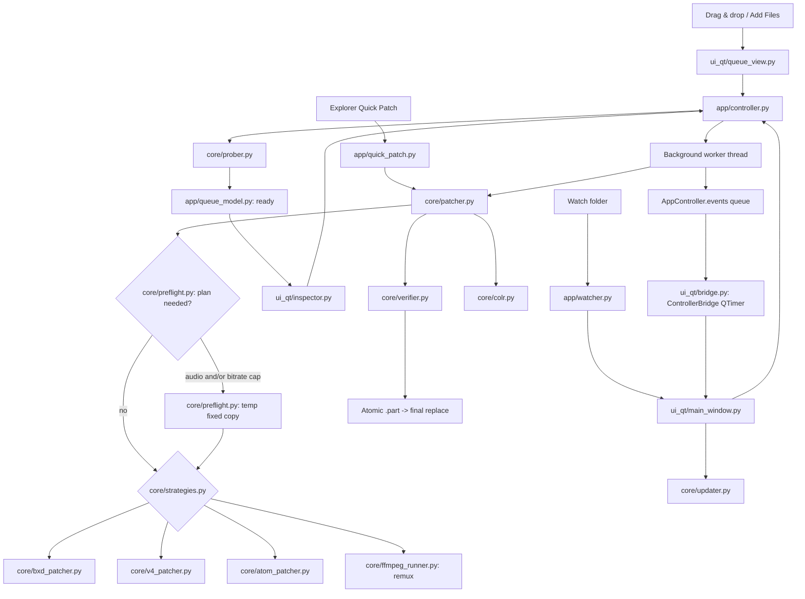

# AI Codebase Summary — FPS Patcher Studio (v1.2.1)

> **Purpose**: Master architecture, codebase map, state lifecycle, and operational guide for autonomous AI agents and engineers working on **FPS Patcher Studio**.

---

## 1. Project Overview & Identity

- **Repository**: `fps-patcher-studio`
- **Root Path**: `E:\Project\fps-patcher-studio`
- **Current Version**: `1.2.1` (2026-11-03)
- **Python Target**: Python 3.11+
- **Desktop Stack**: PySide6 `6.12.0`, Pillow, PyInstaller one-folder build
- **Primary Domain**: High-precision ISO-BMFF (MP4/MOV/M4V) container timing patcher. It modifies video timescales, sample duration tables (`stts`), composition offsets (`ctts`), track/movie headers (`mvhd`, `tkhd`, `mdhd`), and edit lists (`edts`/`elst`) losslessly at the binary atom level **without re-encoding video frames** unless the optional bitrate cap is enabled.
- **User Interface**: Qt is the only UI (`src/fps_patcher/ui_qt/`), with English and Thai localization, light/dark themes, seven theme presets, drag-and-drop, thumbnails, and a bottom activity console.
- **Headless Surface**: `src/fps_patcher/cli.py` (`--cli patch|probe|score`), plus `--quick-patch` for the Explorer verb.
- **Release Status**: v1.2.1 is source-only (not built or tagged). v1.2.0 is published on GitHub Releases and is **unsigned**. SignPath is documented but not active.

---

## 2. Directory & Component Map

```
E:\Project\fps-patcher-studio\
├── build\                          # Build & release packaging
│   ├── fps_patcher.spec            # PyInstaller one-folder windowed spec
│   ├── installer.iss               # Inno Setup 6/7 installer script
│   ├── release.ps1                 # Gates -> PyInstaller -> smoke test -> SBOM -> zip/installer
│   ├── sign_binaries.ps1           # Authenticode signing helper
│   ├── signpath-artifact-configuration.xml
│   ├── version_info.txt            # Windows PE version metadata
│   └── fps_patcher.manifest        # DPI/long-path aware application manifest
├── src\fps_patcher\
│   ├── __init__.py                 # __version__ = "1.2.1", APP_NAME
│   ├── __main__.py                 # Entry dispatch: --cli, --quick-patch, Qt GUI
│   ├── cli.py                      # Headless CLI: patch | probe | score
│   ├── config.py                   # Settings persistence and clamping
│   ├── logging_setup.py            # Rotating file logging
│   ├── app\                        # State, orchestration, automation
│   │   ├── controller.py           # AppController: worker threads + event queue
│   │   ├── queue_model.py          # InputQueue / QueueItem state machine
│   │   ├── quick_patch.py          # One-shot headless patch for the Explorer verb
│   │   ├── shell_integration.py    # HKCU Explorer context-menu registration
│   │   └── watcher.py              # Watch-folder intake with write debounce
│   ├── core\                       # Binary/container logic, no UI imports
│   │   ├── atom_patcher.py         # Low-level atom parser/writer and timescale patch
│   │   ├── bxd_patcher.py          # BXD patch engine (PC/Mobile/Hybrid/Clean/Repair)
│   │   ├── colr.py                 # Lossless Rec.709 colr injection + metadata scrub
│   │   ├── diagnostic_logger.py    # Diagnostic report and log writer
│   │   ├── errors.py               # Domain exception hierarchy
│   │   ├── ffmpeg_downloader.py    # FFmpeg/ffprobe download and extraction
│   │   ├── ffmpeg_locator.py       # Bundled/system FFmpeg discovery
│   │   ├── ffmpeg_runner.py        # ffprobe/ffmpeg subprocess wrappers
│   │   ├── forensic_analyzer.py    # Atom-tree and payload comparison
│   │   ├── models.py               # VideoInfo, PatchRequest, events, constants
│   │   ├── notify.py               # Windows toast notifications
│   │   ├── patcher.py              # probe -> preflight -> patch -> verify orchestration
│   │   ├── platform_profiles.py    # TikTok/Reels/YouTube/generic readiness scoring
│   │   ├── preflight.py            # Audio normalizer + bitrate cap planner/runner
│   │   ├── prober.py               # VideoInfo extraction (ffprobe when available)
│   │   ├── strategies.py           # Strategy registry and preset aliases
│   │   ├── updater.py              # GitHub Releases check/download/verify/launch
│   │   ├── v4_patcher.py           # V4 direct forensic patch engine
│   │   ├── verifier.py             # Post-patch structural/payload verification
│   │   └── win_job.py              # Kill-on-close job objects and named mutexes
│   ├── ui\
│   │   ├── strings.py              # English/Thai i18n dictionary
│   │   └── assets\                 # Icons, fonts, app icon
│   └── ui_qt\                      # Qt (PySide6) presentation layer
│       ├── app.py                  # QApplication + MainWindow entry
│       ├── main_window.py          # Shell, toolbar, wiring, startup update prompt
│       ├── bridge.py               # ControllerBridge: event queue -> Qt signals
│       ├── queue_view.py           # QListView/model delegate queue and drag-drop
│       ├── inspector.py            # FPS/preset/output/bitrate/readiness panel
│       ├── settings_dialog.py      # Seven-tab modal settings, draft/apply
│       ├── console.py              # Collapsible activity console
│       ├── forensic_dialog.py      # Modal forensic comparison dialog
│       ├── theme.py                # Design tokens, density, DWM helpers
│       ├── qss.py                  # Generated Qt style sheets and palettes
│       ├── motion.py               # Easing, fades, slides, progress animation
│       ├── thumbnails.py           # Off-thread thumbnail generation/cache
│       ├── widgets.py              # Card, Switch, SegmentedControl, Popover
│       └── icons.py                # Dual-mode icon loading
├── tests\                          # 40 test_*.py modules, 412 tests
│   ├── conftest.py
│   ├── qt_support.py               # pytest-qt helpers and startup stubs
│   └── test_*.py
├── tools\
│   ├── generate_sbom.py            # CycloneDX SBOM + dependency report
│   ├── bench_audit.py
│   ├── capture_qt_screens.py
│   └── make_icon.py
├── docs\                           # Policies, roadmap, signing, handoff checklists
├── release\                        # Built installers, zips, checksums, SBOM
├── pyproject.toml                  # Version 1.2.1, PySide6 pin, tool config
├── uv.lock                         # Locked dependency graph
├── README.md
├── CHANGELOG.md
└── RELEASE_NOTES.md
```

`src/fps_patcher/ui/` holds only shared localization strings and assets; there is
no second UI toolkit in the runtime.

---

## 3. Module Map by Layer

### 3.1 Entry points

| File | Responsibility |
| --- | --- |
| `src/fps_patcher/__main__.py` | Reads settings, dispatches `--cli` before importing Qt, handles `--quick-patch`, then launches `ui_qt.app.run()`. |
| `src/fps_patcher/cli.py` | Argparse CLI for `patch`, `probe`, and `score`; supports `--json`; exit codes `0` ok, `1` file error, `2` usage, `130` cancelled; never imports Qt. |
| `src/fps_patcher/ui_qt/app.py` | Creates/reuses `QApplication`, sets app identity and icon, constructs `MainWindow`, runs the event loop. |

### 3.2 Application layer

| File | Responsibility |
| --- | --- |
| `app/controller.py` | Toolkit-agnostic `AppController`. Owns `events: queue.Queue[Event]`, worker threads, probe/patch/update/download entry points, cancellation, and shutdown. Workers only put events; they never touch widgets. |
| `app/queue_model.py` | Pure-Python `InputQueue` and `QueueItem`: status transitions, selection, per-item overrides, late-probe filtering, reset for re-patch. |
| `app/watcher.py` | Stdlib-only folder watcher with debounce and backlog priming. |
| `app/shell_integration.py` | Per-user Explorer context-menu registration under `HKCU`. |
| `app/quick_patch.py` | Headless one-shot patch used by `--quick-patch` and the Explorer verb. |

### 3.3 Qt presentation layer (`src/fps_patcher/ui_qt/`)

| File | Responsibility |
| --- | --- |
| `main_window.py` | `QMainWindow` shell: toolbar, queue/inspector split, console drawer, shortcuts, watcher drain, update button and startup prompt, settings/forensic dialogs. |
| `bridge.py` | `ControllerBridge(QObject)`. Drains `controller.events` with a single-shot `QTimer` on the GUI thread and re-emits typed Qt signals (`log`, `progress`, `probe_done`, `patch_done`, `queue_changed`, `ffmpeg`, `update_available`, `update_download`, `drained`). Poll interval is 50 ms while busy, 200 ms idle; `DRAIN_LIMIT = 500`. Also owns the worker-thread seam for forensic tasks. |
| `queue_view.py` | `QueueView` with a `QListView` + `QStyledItemDelegate`. Paints row pills (resolution, FPS source → target, codec · preset, bitrate, size), thumbnails, readiness badge, selection, context actions, and native drag-and-drop. |
| `inspector.py` | Target FPS/timescale, strategy preset, output options, read-only **Bitrate** field, readiness card, per-item override card, and the single progress/start/cancel rail. |
| `settings_dialog.py` | Modal seven-tab settings: appearance, output, patching, FFmpeg, console, behavior, about. Edits a draft, applies on save, previews theme changes. |
| `console.py` | Collapsible activity console with filters, search, clear, and export. |
| `forensic_dialog.py` | Modal forensic analyzer/comparison UI with background worker signals. |
| `theme.py` | Design tokens, density metrics, font resolution, Windows DWM/title-bar helpers. |
| `qss.py` | Builds Qt style sheets and palettes from a resolved `Theme`. |
| `motion.py` | Easing curves, fades, height slides, glow, and animated progress bar. |
| `thumbnails.py` | Thumbnail loading/generation kept off the GUI thread with an LRU cache. |
| `widgets.py` | Shared `Card`, `CardGroup`, `Switch`, `SegmentedControl`, `Popover`, buttons. |
| `icons.py` | Loads the dual-mode PNG icon assets for the active theme. |

### 3.4 Core layer

| File | Responsibility |
| --- | --- |
| `core/models.py` | Frozen dataclasses: `VideoInfo`, `PatchRequest`, `PatchResult`, `LogEvent`, `ProgressEvent`, `ProbeDoneEvent`, `PatchDoneEvent`, `QueueChangedEvent`, `FFmpegDownloadEvent`, `UpdateAvailableEvent`, `UpdateDownloadEvent`, plus `FPS_PRESETS` and supported extensions. |
| `core/prober.py` | Extracts `VideoInfo` (codec, dimensions, FPS, duration, bitrate, audio, color) using ffprobe when available. |
| `core/patcher.py` | Orchestrates one file: validate → probe → preflight plan → strategy patch → color/metadata → verify → atomic replace. Also handles destination locks, backups, overwrite policy, and `preserve_mtime`. |
| `core/preflight.py` | Pure planning helpers (`needs_audio_normalize`, `needs_bitrate_cap`, `planned_output_bitrate`, `make_plan`) and the FFmpeg preflight runner. Owns `BITRATE_TARGET_MBPS_MIN/MAX` (1/24), default 16, hardware-encoder order and `d3d11va` fallback. |
| `core/strategies.py` | Strategy registry: `bxd-pc`, `bxd-mobile`, `bxd-hybrid`, `bxd-clean`, `direct-atom`, `v4-forensic`, `bxd-experimental`, `ffmpeg-copy`, plus legacy aliases. |
| `core/bxd_patcher.py` | BXD direct patch engine and preset variants. |
| `core/v4_patcher.py` | Strict V4 forensic patch engine. |
| `core/atom_patcher.py` | ISO-BMFF box parser/writer and video-track timescale patch. |
| `core/colr.py` | Lossless Rec.709 `colr`/`nclx` injection and `udta`/`meta` scrubbing. |
| `core/verifier.py` | Structural checks, chunk-offset checks, and sampled payload SHA-256 verification. |
| `core/platform_profiles.py` | Read-only platform profiles and deterministic readiness scoring. |
| `core/updater.py` | GitHub Releases API check, SHA-256 verification, installer download/launch; HTTPS GitHub hosts only. |
| `core/ffmpeg_runner.py`, `ffmpeg_locator.py`, `ffmpeg_downloader.py` | FFmpeg subprocess, discovery, and optional download paths. |
| `core/forensic_analyzer.py`, `diagnostic_logger.py` | Forensic diffing and diagnostic report/log generation. |
| `core/notify.py`, `win_job.py`, `errors.py` | Windows toasts, job-object/mutex helpers, domain errors. |

---

## 4. Runtime and Processing Pipeline



1. A file enters through drag-and-drop, **Add Files**, the watch folder, or the Explorer verb.
2. `AppController` starts a probe worker; `core/prober.py` produces `VideoInfo`, and `QueueItem` moves from `probing` to `ready`.
3. `core/patcher.py` builds a preflight plan from that metadata. Audio normalization applies when the audio track is not AAC-LC 48 kHz stereo. Bitrate capping applies only when auto-cap is on **and** the source bitrate is above the selected target.
4. When preflight is needed, FFmpeg writes a temporary fixed copy; the original source is never modified. The selected strategy then patches that working copy.
5. Direct strategies (`bxd-*`, `direct-atom`, `v4-forensic`) rewrite container atoms. `ffmpeg-copy` remuxes with a new video-track timescale. The `mdat` payload stays byte-identical unless the bitrate cap deliberately re-encodes video.
6. `core/colr.py` optionally writes a Rec.709 tag or scrubs metadata. `core/verifier.py` checks structure, offsets, and sampled payload hashes.
7. Output is written to a temp file and atomically renamed. Backups, overwrite confirmation, destination locks, and `preserve_mtime` are handled around that replace.
8. Progress and results are pushed to `AppController.events`; `ControllerBridge` drains them on the GUI thread and emits Qt signals.

### 4.1 Strategy presets

| Preset ID | UI role |
| --- | --- |
| `bxd-mobile` | Default mobile-safe X1T preset |
| `bxd-hybrid` | Mobile-safe structure with a bounded tail extension |
| `bxd-clean` | Timing/faststart rewrite without extra padding |
| `bxd-pc` | Legacy PC-oriented X1T behavior |
| `direct-atom` | Lightweight direct box editor |
| `v4-forensic` | Strict V4 re-mapper with optional report/dry-run |
| `bxd-experimental` | Compatibility alias for the experimental BXD path |
| `ffmpeg-copy` | FFmpeg stream-copy remux with a new timescale |

---

## 5. State Machine and Event Architecture

### 5.1 `QueueItem` lifecycle

```
pending -> probing -> ready -> running -> done
                        |         |
                        v         v
                      error <-----+
                                   |
                         reset_for_run() -> ready
```

- `pending`: added, waiting for a probe worker.
- `probing`: `core/prober.py` is reading metadata. Late results are discarded if the item already moved on.
- `ready`: eligible for patching.
- `running`: owned by the active patch worker.
- `done`: output written and verified (subject to `verify_after`).
- `error`: failure captured in `item.error`.
- Re-patching a `done` or `error` item calls `InputQueue.reset_for_run(paths)`, which clears errors/progress/output and returns it to `ready`.

### 5.2 Thread model and `ControllerBridge`

`AppController` is UI-toolkit agnostic. Background threads only call `controller.emit(event)`, which puts an immutable event on `controller.events`. No worker touches a `QWidget`.

`ControllerBridge` runs on the Qt main thread:

- A single-shot `QTimer` calls `controller.drain(handler, limit=500)`.
- Poll delay is 50 ms while `controller.busy`, otherwise 200 ms.
- Each event type is re-emitted as a Qt signal; `MainWindow` connects those signals to slots.
- Forensic work uses `start_forensic_task`, which runs a callable in a daemon thread and emits only `forensic_status`, `forensic_finished`, or `forensic_failed`.

Event types: `LogEvent`, `ProgressEvent`, `ProbeDoneEvent`, `PatchDoneEvent`, `QueueChangedEvent`, `FFmpegDownloadEvent`, `UpdateAvailableEvent`, `UpdateDownloadEvent`.

---

## 6. UI Layout Specifications

- **Toolbar**: app title, version badge, FFmpeg status/menu, **Forensic**, **Open Output**, conditional **Update vX.Y.Z** button, theme toggle, and **Settings**.
- **Queue column** (`QueueView`): add files/folder, select all/clear, count, drag-and-drop empty state, thumbnail rows, metadata pills, status/progress, readiness badge, and per-row context actions (remove, forensic, override).
- **Inspector** (fixed-width right column): target FPS/timescale, strategy preset, output group, **Bitrate** field, readiness card, per-item override card, and one progress rail with **Start Patch** / **Cancel**.
- **Activity console** (`ConsolePanel`): collapsible bottom drawer with level filters, search, clear, and export.
- **Settings** (`SettingsDialog`): seven tabs with draft/apply semantics and live theme preview.
- **Forensic** (`ForensicDialog`): modal original-vs-patched comparison with background analysis.

---

## 7. v1.2.0 Changes (verified in code)

### 7.1 Bitrate plan in the queue and Inspector

`core/preflight.py::planned_output_bitrate` returns the source bitrate when the
cap does not apply, and the target bitrate when auto-cap is enabled and the source
exceeds the target.

- **Queue pills** (`ui_qt/queue_view.py::row_pills`): when the planned output equals the source, the bitrate pill shows one value (for example `18.4 Mbps`). When the cap applies, it shows `18.4 Mbps → 16.0 Mbps`. Auto-cap off always yields the single source value.
- **Inspector** (`ui_qt/inspector.py::_refresh_bitrate`): a read-only **Bitrate** field shows the source value, or `source → target` when the plan changes it, with an estimated-output tooltip. Missing bitrate data shows `—`.
- Formatting is one decimal place in Mbps (`bps / 1_000_000`).

### 7.2 Adjustable target

- `bitrate_target_mbps` is an `int`, default `16`, clamped to **1–24** on load (`config.py`).
- Settings exposes a spin box over `BITRATE_TARGET_MBPS_MIN..MAX`, step 1, and disables it when **auto-cap** is off (`ui_qt/settings_dialog.py`).
- The same value flows through the GUI (`AppController`), CLI (`--cap-bitrate` uses the saved target), and quick-patch.

### 7.3 Auto-cap behavior

- `needs_bitrate_cap` is strict `source > target`; a source exactly at the target is not capped.
- Off, or at/below the target: video is copied losslessly. Above the target with auto-cap on: video is re-encoded to H.264 at the selected rate.
- Encoder order is `h264_nvenc`, `h264_amf`, `h264_qsv`, then `libx264`. The v1.1.0 AV1 fix adds `-hwaccel d3d11va` with a software-decode retry.

### 7.4 Startup update prompt

- `MainWindow` calls `controller.check_for_updates_background(__version__)` at startup when `check_updates_on_start` is enabled.
- An `UpdateAvailableEvent` shows the toolbar update button and schedules the existing confirmation dialog.
- The dialog still asks before downloading/installing; declining leaves the update button available. The prompt runs once per session (`_update_prompted`).
- Network failures are swallowed by the controller's background worker (debug log only), so startup is not blocked.

### 7.5 Base from v1.1.0

The v1.2.0 release also carries the v1.1.0 fixes: runtime wiring for `verify_after`, `backup_original`, `preserve_mtime`, `stop_on_error`, `extra_ffmpeg_args`, `log_to_file`, `confirm_overwrite`, and `notify_done`; two-stage Ctrl+C; updater response cleanup; Thai readiness labels; and the AV1 preflight acceleration.

---

## 8. Development, Quality Gates & Release Workflow

### 8.1 Run the app

```powershell
cd E:\Project\fps-patcher-studio
uv sync
uv run fps-patcher-studio
```

CLI examples:

```powershell
uv run fps-patcher-studio --cli probe "clip.mp4"
uv run fps-patcher-studio --cli patch "clip.mp4" --preset 60 --output out
uv run fps-patcher-studio --cli score "clip.mp4" --profile tiktok --json
```

### 8.2 Mandatory quality gates

```powershell
uv run ruff check src tests tools
uv run mypy src tests tools
uv run pytest -q
```

Current baseline:

- `ruff`: clean.
- `mypy`: clean across **95 source files**.
- `pytest`: **412 tests** collected from **40 `test_*.py` modules** (plus `conftest.py` and `qt_support.py` helpers).

### 8.3 Build and release

```powershell
# Build the standalone folder
uv run --with pyinstaller pyinstaller build/fps_patcher.spec --noconfirm

# Full release pipeline
powershell -ExecutionPolicy Bypass -File build\release.ps1
```

`build/release.ps1` runs the gates (unless `-SkipChecks`), builds with
PyInstaller, smoke-tests the executable, optionally compiles the Inno Setup
installer, generates the CycloneDX SBOM via `tools/generate_sbom.py`, writes
SHA-256 sidecars and a JSON manifest, and packages the portable ZIP.
`.github/workflows/release.yml` runs the same path on `windows-latest`, uploads
unsigned artifacts, and submits to SignPath only when `SIGNPATH_ENABLED=true`.

### 8.4 Operational notes

- Settings: `%APPDATA%\FPSPatcherStudio\settings.json`; window geometry also uses `QSettings("FPSPatcherStudio", "QtUI")`.
- Logs: rotating file logging controlled by `log_to_file`.
- Release artifacts are unsigned; `docs/CODE_SIGNING_SIGNPATH.md` describes the blocked SignPath path. Do not describe v1.2.0 as signed.
