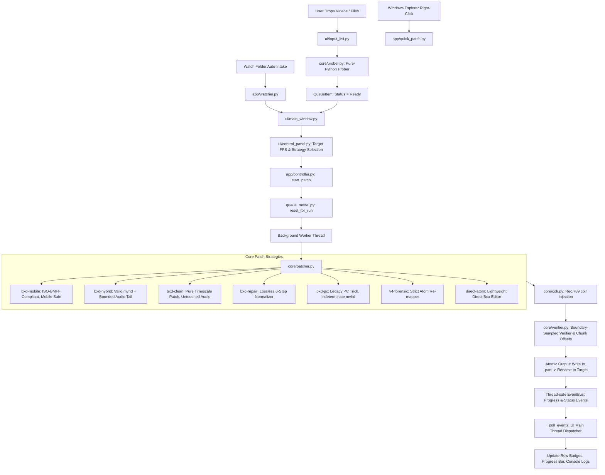

# AI Codebase Summary — FPS Patcher Studio (v0.7.0)

> **Purpose**: Master architecture, codebase map, state lifecycle, and operational guide for autonomous AI agents and engineers working on **FPS Patcher Studio**.

---

## 1. Project Overview & Identity
- **Repository**: `fps-patcher-studio`
- **Root Path**: `E:\Project\fps-patcher-studio`
- **Current Version**: `0.7.0`
- **Python Target**: Python 3.11+
- **Primary Domain**: High-precision ISO-BMFF (MP4/MOV) container timing patcher. It modifies video timescales, sample duration tables (`stts`), composition offsets (`ctts`), track/movie headers (`mvhd`, `tkhd`, `mdhd`), and edit lists (`edts`/`elst`) losslessly at the binary atom level **without re-encoding video frames**.
- **User Interface**: CustomTkinter 6.0+ styled with Apple HIG desktop aesthetic, WCAG AA obsidian dark theme, double-buffered Win32 GDI composite repaint (`RDW_ALLCHILDREN`), drag-and-drop (`tkinterdnd2`), and localized bilingual support (English & Thai).

---

## 2. Directory & Component Map

```
E:\Project\fps-patcher-studio\
├── build\                          # Build & release packaging configurations
│   ├── fps_patcher.manifest        # DPI-aware, LongPath-aware Windows application manifest
│   ├── fps_patcher.spec            # PyInstaller one-folder windowed spec
│   ├── installer.iss               # Inno Setup 6 installer compilation script
│   ├── release.ps1                 # Automation: gates -> pyinstaller -> smoke test -> portable zip
│   ├── sign_binaries.ps1           # Authenticode code signing automation
│   └── version_info.txt            # Windows PE binary resource version metadata
├── dist\FPSPatcherStudio\          # Compiled standalone distribution
│   └── FPSPatcherStudio.exe        # Portable binary
├── release\                        # Packaged release archives (.zip & .exe installers)
├── src\fps_patcher\                # Source root
│   ├── __init__.py                 # Version (__version__ = "0.7.0")
│   ├── __main__.py                 # Entry point: CLI dispatch, logging setup, config load, and MainWindow
│   ├── config.py                   # User settings persistence (%APPDATA%\FPSPatcherStudio\settings.json)
│   ├── logging_setup.py            # Central logging initialization with rotating file handler
│   ├── app\                        # Application state, orchestration & event system
│   │   ├── __init__.py
│   │   ├── controller.py           # AppController: background worker thread, event dispatch, run loop, shutdown
│   │   ├── queue_model.py          # InputQueue & QueueItem: state machine, selection, persistence, late probe filter
│   │   ├── quick_patch.py          # Standalone headless / Explorer context menu patch executor
│   │   ├── shell_integration.py    # Windows Registry integration for Explorer right-click context menu
│   │   └── watcher.py              # FolderWatcher background monitoring with debounced write completion
│   ├── core\                       # Binary atom manipulation & container strategies
│   │   ├── __init__.py
│   │   ├── atom_patcher.py         # Low-level binary box parser, writer, container traverser
│   │   ├── bxd_patcher.py          # BXD 5-preset patch engine (PC, Mobile, Hybrid, Clean, Repair) with 8MB streaming
│   │   ├── colr.py                 # Lossless Rec.709 colr/nclx injection & metadata scrubber
│   │   ├── diagnostic_logger.py    # Forensic telemetry & structured audit logs
│   │   ├── errors.py               # Exception hierarchy (PatcherError, ValidationError, etc.)
│   │   ├── ffmpeg_downloader.py    # In-app background FFmpeg/FFprobe auto-downloader and extractor
│   │   ├── ffmpeg_locator.py       # Detection for bundled/system ffmpeg & ffprobe binaries
│   │   ├── ffmpeg_runner.py        # FFmpeg process wrapper for fallback probing/copying
│   │   ├── forensic_analyzer.py    # Deep atom-tree, semantic field, byte-span & mdat hash diffing
│   │   ├── models.py               # Core data structures (VideoInfo, PatchSettings, JobProgress, etc.)
│   │   ├── notify.py               # Native Windows toast notification emitter with PowerShell/fallback
│   │   ├── patcher.py              # Strategy dispatcher facade with per-job atomic temp file management
│   │   ├── preflight.py            # Pre-flight audio normalizer (AAC 48kHz) & bitrate limiter (<18M)
│   │   ├── prober.py               # Pure-Python zero-dependency MP4/MOV header metadata parser
│   │   ├── strategies.py           # Enumeration & registry of patch algorithms
│   │   ├── updater.py              # GitHub Releases update check, SHA-256 verification & installer launch
│   │   ├── v4_patcher.py           # Strict ISO-BMFF V4 forensic patcher with memory-mapped buffer
│   │   └── verifier.py             # Boundary-sampled pre/post-patch verification suite (<2ms, memory-mapped)
│   └── ui\                         # CustomTkinter User Interface (Apple HIG Layout)
│       ├── __init__.py
│       ├── main_window.py          # Main application window, 3-column layout, poll loop, shortcuts
│       ├── input_list.py           # File Queue view: cards, selection bar, preview player, drop zone
│       ├── control_panel.py        # Inspector: Target FPS, Timescale, Presets, Overrides, Progress
│       ├── info_panel.py           # Media inspector: metadata, streams, atom hierarchy
│       ├── log_console.py          # Collapsible dark console drawer with filter/search/export
│       ├── settings_window.py      # Modal Settings dialog host
│       ├── settings_tabs\          # Modular settings pages (appearance, patching, output, ffmpeg, console, about)
│       ├── theme.py                # Color tokens, typography, solid dark surface, title bar sync
│       ├── strings.py              # Bilingual localization dictionary (EN & TH)
│       ├── icons.py                # 32x32 light/dark PNG icon asset loader
│       ├── thumbnails.py           # Background thumbnail generator with LRU cache eviction (max 128)
│       ├── drop_zone.py            # Visual drag-over indicator
│       ├── option_menu.py          # Custom styled popover dropdown
│       ├── segmented_control.py    # MacSegmentedControl with sliding cubic-bezier capsule indicator
│       └── forensic_window.py      # Side-by-side atom forensic comparison window
└── tests\                          # 286 Automated unit & integration tests across 28 test suites
    ├── conftest.py                 # Pytest fixtures, mock video samples, temporary test roots
    ├── test_app.py                 # Application lifecycle, controller initialization, worker shutdown
    ├── test_atom_patcher.py        # Low-level atom parsing, unpacking, box replacement
    ├── test_bxd_audio_verify.py    # Audio ghost frames and ISO-BMFF audio verification
    ├── test_bxd_bypass.py          # BXD bypass edge-cases and error handling
    ├── test_bxd_presets_and_repair.py # All 5 BXD presets and 6-step mobile repair
    ├── test_capability_and_verifier.py# Hash checks, chunk bounds, validation gates
    ├── test_colr.py                # Rec.709 colr/nclx injection and metadata scrubber tests
    ├── test_core.py                # Core models, prober, strategies
    ├── test_ffmpeg_downloader.py   # FFmpeg auto-download, extraction, progress and caching tests
    ├── test_fixture_matrix.py      # Test matrix with multiple container types
    ├── test_integration.py         # End-to-end patch pipeline tests
    ├── test_macos_controls_and_focus.py # Focus rings, segmented controls, macOS HIG styling
    ├── test_motion_and_segmented.py# Animated easing curve and motion toggle tests
    ├── test_packaging_and_manifest.py # PE version resource and manifest validity
    ├── test_phase2_hig_integration.py # Phase 2 UI integration and event handling
    ├── test_preflight_and_updater.py # Pre-flight normalizer and GitHub Releases updater
    ├── test_queue_model.py         # Queue item state machine, snapshots, late probe filtering
    ├── test_queue_selection_patch.py# Queue selection toolbar, Clear All action, re-patching
    ├── test_settings_v2.py         # Settings serialization, persistence, defaults, concurrency lock
    ├── test_shell_and_quick_patch.py # Windows Explorer registry integration and quick patch CLI
    ├── test_theme_typography.py    # GDI font loader and typography metrics
    ├── test_ui_icons_and_layout.py # Icon resolution and layout constraints
    ├── test_ui_poll_and_context.py # EventBus polling, Tk thread isolation, context menus
    ├── test_v050_features.py       # Zero-freeze streaming engine and mobile faststart tests
    ├── test_v4_forensic.py         # V4 forensic patcher atom integrity
    ├── test_watch_integration.py   # Watch folder end-to-end integration
    └── test_watcher.py             # Watch folder debounce and filesystem monitoring
```

---

## 3. Core Architecture & Processing Pipeline



### 3.1. How Container Timing Patching Works
Traditional video frame interpolation or re-encoding degrades picture quality and takes considerable CPU/GPU time. FPS Patcher Studio:
1. Opens MP4/MOV container binary.
2. Locates the video track (`trak -> mdia -> mdhd`, `stbl -> stts`, `ctts`).
3. Scales the timescale or sample durations (`sample_delta = round(original_delta * (src_fps / target_fps))`).
4. Updates container-level headers (`mvhd`, `tkhd`, `edts`) so player timing matches the target framerate.
5. Injects or normalizes Rec.709 `colr`/`nclx` tags inside the video sample description (`stsd`).
6. Enforces progressive faststart by relocating `moov` before `mdat` and recalculating all chunk offsets (`stco`/`co64`).
7. Keeps `mdat` (video sample payload data) 100% byte-identical via 8MB chunked streaming writes.
8. Verifies container boundaries via memory-mapped boundary-sampled SHA-256 checks (<2ms) and renames atomic `.part` temp file to target.

### 3.2. BXD Strategy Presets Deep-Dive
| Preset ID | Display Name | Audio Treatment | Standards Compliance | Ideal Target |
| :--- | :--- | :--- | :--- | :--- |
| `bxd-mobile` | **X1T For Mobile** | Untouched audio stream, strict ISO-BMFF | **100% ISO-BMFF** | iOS AVPlayer, Android MediaCodec, Mobile apps |
| `bxd-hybrid` | **X1T Hybrid** | Bounded last-sample extension (`<=200ms`) | Valid headers | Mixed desktop/mobile workflows |
| `bxd-clean` | **X1T Clean** | Audio completely untouched | Strict | Direct video-only timescale updates |
| `bxd-repair` | **X1T Repair** | 6-step normalization of broken containers | Validated | Fixing broken BXD files for playback |
| `bxd-pc` | **X1T For PC** | Appends ~10x ghost frames & unboxed bytes | Non-standard (Legacy) | Desktop players & PC tricks |

### 3.3. Key Phase 2 Features
- **Watch Folder Auto-Intake (`app/watcher.py`)**:
  - Automatically monitors user-designated directories for newly rendered media files.
  - Implements filesystem debouncing (waits for file write completion before dispatching).
  - Automatically adds finished exports to queue or triggers auto-patching based on settings.
- **Windows Explorer Shell Integration (`app/shell_integration.py`, `app/quick_patch.py`)**:
  - Registers right-click context menu handler ("Quick Patch with FPS Patcher Studio") in Windows Registry (`HKCU\Software\Classes`).
  - Executes instant headless background patch and displays Windows native toast notification upon completion.
- **Lossless Rec.709 Color Guard (`core/colr.py`)**:
  - Inspects ISO-BMFF `moov.trak.mdia.minf.stbl.stsd` video sample descriptions.
  - Injects compliant Rec.709 `colr` (`nclx`, primaries=1, transfer=1, matrix=1, full_range=False) boxes into MP4 files without modifying pixel data.
  - Strips conflicting or corrupted QuickTime NCLC tags to guarantee identical color rendering on Apple QuickTime and Windows/Chromium players.

---

## 4. State Machine & Event Architecture

### 4.1. `QueueItem` State Lifecycle
```
[Unprobed File] ──> pending ──> probing ──> ready ──> running ──> done (Completed)
                                              │                    │
                                              └──> error           └──> (Re-patch triggered)
                                                                           │
                                                                           └──> reset_for_run() ──> ready
```
- **State Transition Details**:
  - `pending`: File added to queue; waiting for probing thread.
  - `probing`: Header is being parsed by `core/prober.py` (extracts resolution, duration, codec, fps). Late probe results are discarded if state already moved to `running` or `done`.
  - `ready`: Ready for patching.
  - `running`: Currently being processed by the worker thread.
  - `done`: Successfully patched. Output file generated.
  - `error`: Failed during patch or verification. Error message captured in `item.error`.
  - **Re-patching**: When `Start Patch` or `Apply Selected` runs on `done` or `error` items, `InputQueue.reset_for_run(paths)` automatically clears errors, resets progress to `0.0`, clears output path, and restores state to `ready`.

### 4.2. EventBus & Thread Isolation
CustomTkinter and Tkinter are **not thread-safe**. Background threads must never touch UI widgets directly.
- Background worker thread posts events to `AppController._event_queue`.
- UI main thread polls `AppController.poll_events()` in `MainWindow._poll_events()`.
- **Event Types**:
  - `LogEvent(message, level)`: Routed to `LogConsole` and logging subsystem.
  - `ProgressEvent(item_index, total_items, percent, status_text)`: Updates progress bar.
  - `StatusEvent(text)`: Pinned footer status indicator.
  - `QueueChangedEvent(action)`: Triggers UI queue re-rendering (`action` in `"added"`, `"removed"`, `"cleared"`, `"reset"`, `"updated"`).
  - `FFmpegDownloadEvent(stage, progress, text, paths)`: Asynchronous FFmpeg download and auto-configuration state.

---

## 5. UI Layout Specifications (Apple HIG Desktop Theme)

- **Toolbar (`~52px`)**:
  - Left: App Title and unified Status Badge (`● Ready`, `● Patching`, `● Done`, `● FFmpeg`).
  - Right: Quick Actions (Theme toggle Light/Dark, Watch Folder toggle, Forensic Analyzer, Settings modal, Output folder shortcut).
- **Left Column: File Queue (`InputList`)**:
  - Header: Add Files (`+ Add Files`), Add Folder (`+ Add Folder`), Selection toolbar (`Select All`, `Clear Selection`, `Clear All`), Counter (`X of Y selected`).
  - Cards: Rounded rectangular cards with thumbnail preview, video badges (FPS, Codec, Resolution), progress bar, status pill, and context menu.
- **Right Column: Inspector (`ControlPanel` + `InfoPanel`)**:
  - Top: Inspector Header with file summary.
  - Controls: Target FPS selector (`MacSegmentedControl`), Timescale multiplier, Strategy/Preset combo box, Color Guard toggle, Output mode.
  - Focused Item Override: Collapsible section allowing per-file custom FPS/strategy overrides.
  - Pinned Footer: Progress percentage, status text, and primary `Start Patch` / `Cancel` button.
- **Drawer: Activity Console (`LogConsole`)**:
  - Collapsible dark (`#141417`) bottom console drawer with real-time logs, level filters (`ALL`, `INFO`, `WARN`, `ERROR`), search query box, clear button, and overflow menu.

---

## 6. Development, Quality Gates & Release Workflow

### 6.1. Running the Application
- **Direct Development Mode**:
  ```powershell
  cd E:\Project\fps-patcher-studio
  uv run fps-patcher-studio
  ```
- **Direct Compiled Executable**:
  ```powershell
  .\dist\FPSPatcherStudio\FPSPatcherStudio.exe
  ```

### 6.2. Mandatory Quality Gates
All commits and modifications must pass all three gates with zero errors:
```powershell
# 1. Linter
uv run ruff check src tests

# 2. Strict Type Checker (81 source files)
uv run mypy src tests

# 3. Test Suite (286 tests across 28 test suites)
uv run pytest -q
```

### 6.3. PyInstaller Build & Packaging
```powershell
# Build standalone folder
uv run --with pyinstaller pyinstaller build/fps_patcher.spec --noconfirm

# Run full automated release pipeline (Quality gates -> Build -> Smoke test -> Zip -> Installer)
powershell -ExecutionPolicy Bypass -File build\release.ps1
```
