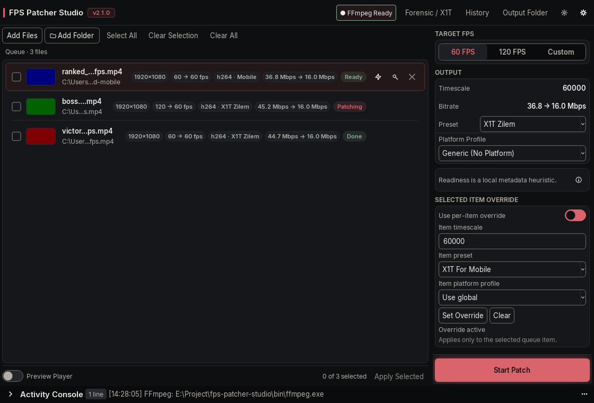

# FPS Patcher Studio

A Windows desktop app and CLI that change the timing metadata of MP4, MOV, and M4V files without re-encoding the video.


<p align="center">
  
</p>

## How it works

A converter that changes frame rate typically decodes the video and encodes it again. FPS Patcher Studio works on the container instead. It parses the ISO-BMFF structure, rewrites the atoms that hold timing and offsets, and copies the `mdat` payload byte for byte.

The video payload comes out unchanged. The audio payload is copied as well, except when the app's default pre-flight pass converts a non-AAC track to AAC 48 kHz stereo (see Limitations). The layout also stays progressive: `moov` moves in front of `mdat` and chunk offsets are recalculated, so players can start before the file is fully read.

## Features

- Set a 60 fps or 120 fps timescale, or enter a custom value.
- Edit `mvhd`, `tkhd`, `mdhd`, `stts`, `ctts`, `stco`, `co64`, and `elst` in place.
- Convert QuickTime `.mov` files to standard MP4 branding.
- Tag untagged SDR video as Rec.709, or strip leftover metadata.
- Repair a PC-only X1T clip from the Forensic window.
- Queue batches with thumbnails, per-item overrides, selection checkboxes, and live probe data.
- Watch a folder and pick up clips when renders finish.
- Run in the system tray after closing the window, and optionally start with Windows.
- Configure the essentials in four Settings tabs, with technical options under Advanced.
- Patch straight from Explorer with **Quick Patch with X1T**.
- Score clips against TikTok, Instagram Reels, YouTube Shorts, or generic upload rules.
- Inspect atoms, color parameters, sample counts, A/V drift, and payload hashes in the Forensic window.
- Choose from seven theme presets in the Crimson Graphite design, with an English or Thai interface.

## Install

Download the installer or the portable zip from [Releases](https://github.com/x1Swimzft/FPS-Patcher-Studio/releases). The newest public build can lag behind `main`.

Verify the download before running it:

```powershell
Get-FileHash .\FPSPatcherStudio-*-Setup.exe -Algorithm SHA256
Get-Content .\FPSPatcherStudio-*-Setup.exe.sha256
```

The builds are unsigned. Windows SmartScreen may show an "Unknown publisher" warning. Use the hash to confirm the file matches the published build. Signing policy and the SignPath Foundation application are documented in [docs/CODE_SIGNING_POLICY.md](docs/CODE_SIGNING_POLICY.md).

## Patch a file

1. Launch the app.
2. Drop one or more `.mp4`, `.mov`, or `.m4v` files on the window, or use **Add Files**.
3. Pick 60, 120, or Custom, then choose a preset. X1T For Mobile is the default.
4. Press **Start Patch**.
5. Patched files land next to the source unless you set another output folder in Settings.

FFmpeg is used for thumbnails, audio normalization, and bitrate capping. FFprobe gives richer metadata when present, but the app can fall back to its own container parser. If neither binary is found, the app offers to download a build, or you can point Settings at an existing `bin` folder.

## Presets

| Preset | Best for | What changes |
| --- | --- | --- |
| **X1T For Mobile** (default) | Phones and social uploads | Faststart `moov`, rewritten timing, `free` box padding, `mvhd` duration set to -1. No ghost samples. |
| **X1T Hybrid** | Mixed desktop and mobile playback | Mobile-safe structure plus a tail extension on the last video sample (default 50 ms). |
| **X1T Clean** | Archival and strict players | Faststart and timing rewrite only. No padding, no ghost samples. |
| **X1T For PC** (legacy) | Desktop players | Ghost audio samples and trailing bytes from the original method. Some mobile decoders reject it. |

All four presets write an indeterminate `mvhd` duration (`-1`), which makes the container report a stream of unknown length. Platform ingest pipelines can still re-encode or reject a file no matter what the header says, so treat this as a heuristic. [docs/PLATFORM_PRESETS.md](docs/PLATFORM_PRESETS.md) lists the published platform rules and labels each check as documented, recommended, or heuristic.

## Command line

```powershell
fps-patcher-studio --cli probe "clip.mp4"
fps-patcher-studio --cli patch "clip.mp4" --preset 60 --output out
fps-patcher-studio --cli score "clip.mp4" --profile tiktok --json
```

In the installed build, start with `FPSPatcherStudio.exe --cli` instead. `--preset` accepts `60` or `120`; use `--timescale` for anything else. Exit codes are 0 for success, 1 for a file error, 2 for a usage error, and 130 for a cancelled run. `patch` also accepts `--overwrite` or `--auto-rename`, `--normalize-audio`, `--cap-bitrate`, `--tag-bt709`, `--scrub-metadata`, and `--json`.

## What gets verified

After each patch, the app checks the new file and writes the results to the Activity Console:

- atom structure and trailing data
- chunk offsets after the faststart shift
- sample tables and track durations
- basic mobile playback compatibility
- sampled SHA-256 of the `mdat` head, middle, and tail, plus the per-track sample bytes

The same checks are available in the Forensic window. A payload failure is logged as an error, but the check does not replace a playback test on a real device. `verify_after` turns the report off. When the destination already exists and backups are enabled, the old file is kept as a `.bak` copy before the atomic replace.

## Build from source

Python 3.11 or newer and [uv](https://docs.astral.sh/uv/) are required.

```powershell
git clone https://github.com/x1Swimzft/FPS-Patcher-Studio.git
cd FPS-Patcher-Studio
uv sync
uv run fps-patcher-studio
```

Run the quality gates:

```powershell
uv run pytest -q
uv run mypy src tests tools
uv run ruff check src tests tools
```

To build the portable zip and installer:

```powershell
powershell -ExecutionPolicy Bypass -File build\release.ps1
```

The script builds with PyInstaller through `uv`. Inno Setup 6 or 7 is optional and only needed for `Setup.exe`. Artifacts, SHA-256 sidecars, a JSON manifest, and a CycloneDX SBOM are written to `release/`. [BUILDING.md](BUILDING.md) has the full toolchain and troubleshooting notes.

## Privacy and network access

The app has no telemetry, analytics, or crash reporting. Media files are processed locally and never uploaded. Network access happens in two cases: the startup update check against GitHub release metadata, and an FFmpeg download that you request from Settings. [docs/PRIVACY.md](docs/PRIVACY.md) has the full policy.

## Limitations

- A timing change is not frame interpolation. A 30 fps recording still holds 30 frames for every second of content; the container just presents a different clock. Motion will not become smoother.
- The X1T engine rejects fragmented MP4 files (`moof`).
- Bitrate capping re-encodes video above the target. It is off by default.
- Audio normalization converts non-AAC audio to AAC 48 kHz stereo and is on by default in the app. Turn it off in Settings to keep the original audio stream.
- Platform profiles score local files against published and heuristic rules. They do not guarantee that a platform will skip re-encoding, keep the uploaded resolution, or accept the file.
- The published builds target Windows 10 and 11 on x64.

## Security and project docs

- [SECURITY.md](SECURITY.md): vulnerability disclosure and response targets.
- [docs/CODE_SIGNING_POLICY.md](docs/CODE_SIGNING_POLICY.md): signing policy and SignPath Foundation details.
- [docs/FALSE_POSITIVE_DISPUTES.md](docs/FALSE_POSITIVE_DISPUTES.md): false-positive dossier for antivirus vendors.
- [THIRD_PARTY_NOTICES.md](THIRD_PARTY_NOTICES.md): bundled components, fonts, and FFmpeg licensing.
- [CHANGELOG.md](CHANGELOG.md): release history.

## License

This project is licensed under the [MIT License](LICENSE).
